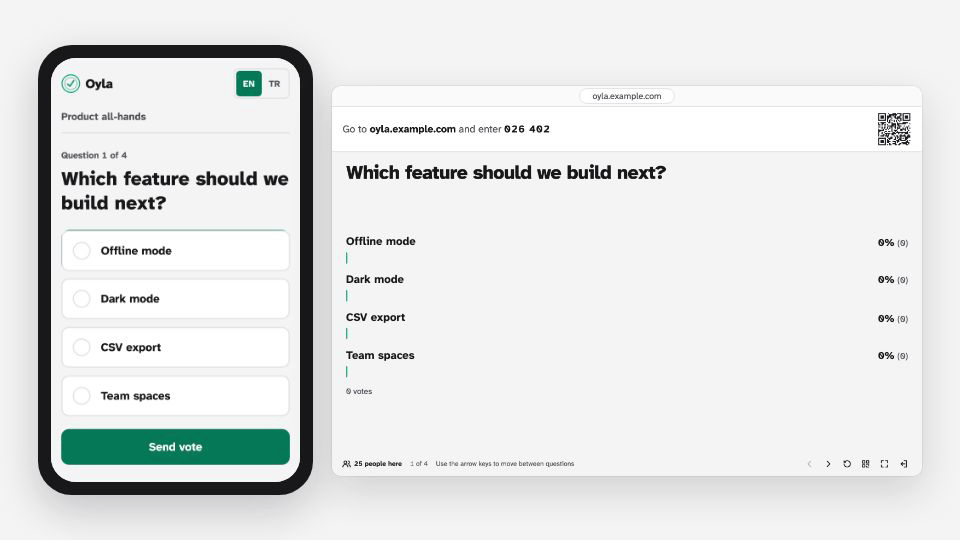
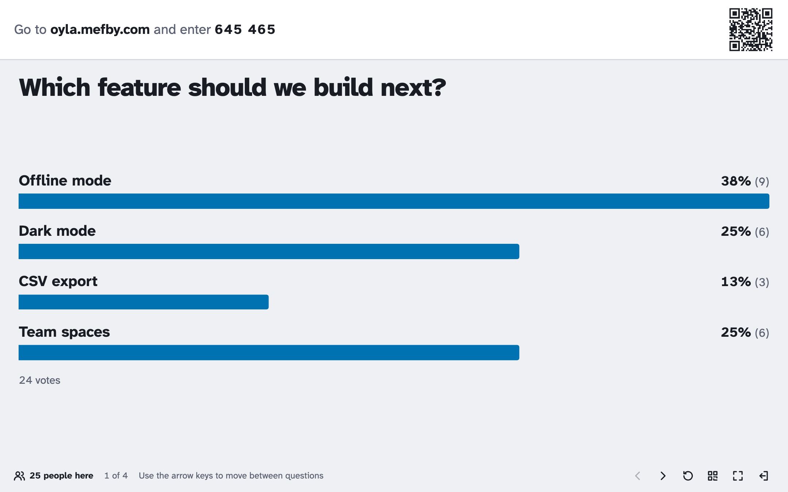
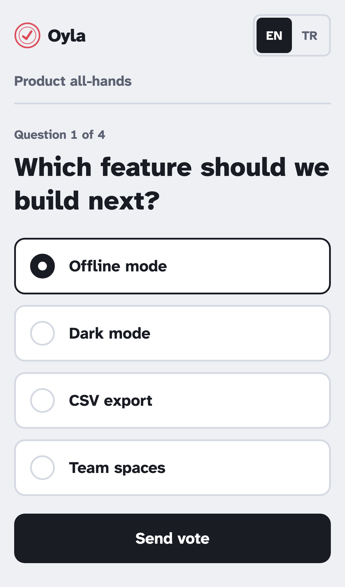
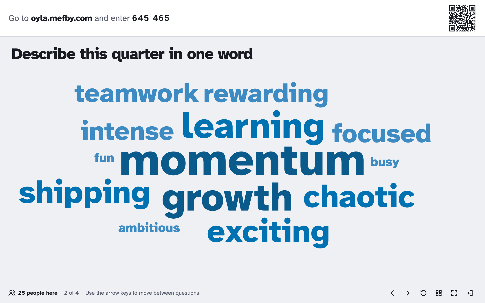
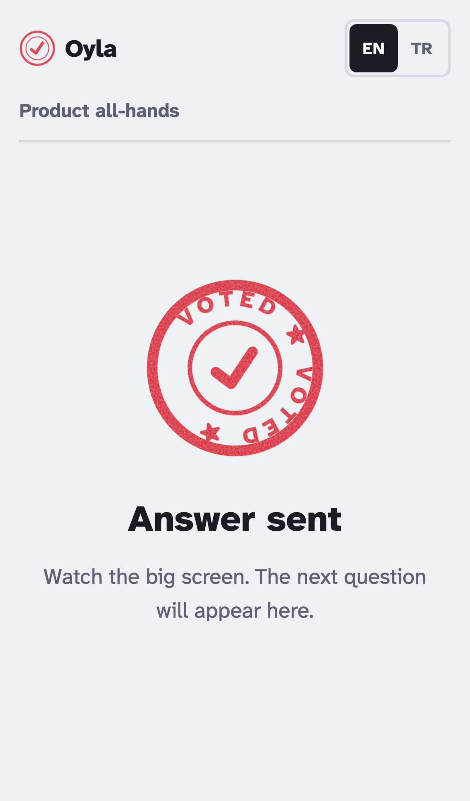

<p align="center">
  
</p>

<h1 align="center">Oyla</h1>

<p align="center">
  Open-source live polls, word clouds and open questions for talks, classes and meetings.<br>
  Your audience joins from their phones with a 6-digit code. Results update live on your screen.
</p>

<p align="center">
  <a href="https://oyla.mefby.com">Documentation</a> ·
  <a href="#run-it-yourself">Self-host</a> ·
  <a href="#türkçe">Türkçe</a>
</p>

<p align="center">
  
</p>

<p align="center">
  <a href="https://oyla.mefby.com">Watch the demo</a> on the documentation site.
</p>

"Oyla" means "vote!" in Turkish. It does what you would use Mentimeter or Slido for in a small
room, without accounts, apps or a subscription.

Oyla is self-hosted: there is no hosted Oyla service to sign up for. You run it on your own
computer or server as one Docker container, and your presentations and answers stay there.

## Features

- **Four question types:** multiple choice, word cloud, open question and scale.
- **Join in seconds:** participants open the site, type the code or scan the QR code. No sign-up.
- **Live results** on the presenter screen, built for projectors: large type, high contrast,
  keyboard navigation (← →), full screen.
- **Presentation themes:** give each presentation one of four colour themes (Emerald, Indigo,
  Navy & orange, Classic blue). The presenter screen and every phone use it, and phones switch
  right away when you change it during a session.
- **No accounts:** creating a presentation gives you a private admin link. Optionally, the server
  owner can require a password to create presentations.
- **English and Turkish** interface, light and dark mode.
- **Small and self-contained:** one Node.js process, one SQLite file, no external services.
- **Easy to extend:** a question type is one shared definition plus three React components.

| Presenter screen | Phone |
|---|---|
|  |  |
|  |  |

## Run it yourself

### With Docker

```bash
docker build -t oyla .
docker run -d --name oyla -p 3000:3000 -v oyla-data:/data oyla
```

Open <http://localhost:3000>. Everything is stored in the `oyla-data` volume
(`/data/oyla.db`). A [`docker-compose.yml`](docker-compose.yml) example is included.

To let people join over the internet, put it behind HTTPS. The
[Docker guide](https://oyla.mefby.com/self-hosting/docker/) covers reverse proxies, and the
[Railway guide](https://oyla.mefby.com/self-hosting/railway/) walks through a deployment with a
custom domain; any host with WebSockets and a persistent disk works.

### From source

Requires Node.js 24.

```bash
npm install
npm run build
npm start            # http://localhost:3000
```

### Configuration

| Variable | Default | What it does |
|---|---|---|
| `PORT` | `3000` | HTTP port |
| `HOST` | `0.0.0.0` | Address to listen on |
| `OYLA_DB_PATH` | `./data/oyla.db` | SQLite file (`/data/oyla.db` in Docker) |
| `OYLA_CREATE_PASSWORD` | unset | When set, creating a presentation requires this password |
| `OYLA_RETENTION_DAYS` | `30` | Delete presentations nobody used for this many days; `0` keeps them |
| `OYLA_TRUST_PROXY` | `false` | Behind a reverse proxy: `true` (one proxy) or the number of proxies |
| `OYLA_LOG_LEVEL` | `info` | `fatal`, `error`, `warn`, `info`, `debug`, `trace` or `silent` |
| `OYLA_RATE_LIMIT_API_PER_MINUTE` | `600` | API requests per minute per IP |
| `OYLA_RATE_LIMIT_CREATE_PER_HOUR` | `10` | New presentations per hour per IP |
| `OYLA_MAX_DB_MB` | `1024` | Largest database file in MB; `0` means no limit |

More in the [configuration docs](https://oyla.mefby.com/self-hosting/configuration/).

## How it works

```
 Phones ──────────┐
 Presenter view ──┼── HTTP + Socket.IO ──►  Node.js (Fastify)  ──►  SQLite
 Editor ──────────┘                          serves the web app too
```

- `packages/shared`: zod schemas, the typed Socket.IO protocol and the question-type registry,
  used by both sides.
- `packages/server`: Fastify REST API for editing, Socket.IO for live sessions, SQLite through
  Drizzle ORM.
- `packages/web`: React app with the home page, editor, presenter view and the participant screen.

The [architecture page](https://oyla.mefby.com/development/architecture/) explains the data model
and the live protocol.

## Development

```bash
npm install
npm run dev          # server on :3000 and the web app on http://localhost:5173
npm test             # unit and integration tests (Vitest)
npm run typecheck
npm run lint         # Biome
npm run build && npm run e2e   # end-to-end test (Playwright)
```

## Contributing

Contributions are welcome, from typo fixes to new question types. Start with
[CONTRIBUTING.md](CONTRIBUTING.md); the [roadmap](ROADMAP.md) lists bigger features that are open
for help, such as quizzes, audience Q&A and scaling to several servers.

Found a security problem? Please report it privately, see [SECURITY.md](SECURITY.md).

## License

[MIT](LICENSE)

---

## Türkçe

**Oyla**, sunumlar, dersler ve toplantılar için açık kaynaklı bir canlı oylama aracı.
Katılımcılar telefonlarından 6 haneli bir kodla katılır ve sonuçlar ekranınızda canlı olarak
güncellenir. Hesap, uygulama ya da abonelik gerekmez.

Oyla'yı kendi sunucunuzda çalıştırırsınız; üye olabileceğiniz hazır bir Oyla servisi yok.
Sunumlarınız ve cevaplar sizin makinenizde kalır.

- **Dört soru tipi var:** çoktan seçmeli, kelime bulutu, açık uçlu soru ve ölçek.
- **Sunum temaları:** Her sunuma dört renk temasından birini verebilirsiniz (Zümrüt, İndigo,
  Lacivert ve turuncu, Klasik mavi). Sunum ekranı da telefonlar da bu temayı kullanır.
- **Hesap gerekmez:** Sunumu oluşturduğunuzda size özel bir yönetici linki verilir.
- **Arayüz** Türkçe ve İngilizce, açık ve koyu modla kullanılabilir.
- **Kurulumu kolay:** Tek bir Docker konteyneri ve tek bir SQLite dosyası yeterli.

Hızlı başlangıç:

```bash
docker build -t oyla .
docker run -d --name oyla -p 3000:3000 -v oyla-data:/data oyla
```

Ardından <http://localhost:3000> adresini açın. Tanıtım videosu ve ayrıntılı Türkçe rehber
[dokümantasyon sitesinde](https://oyla.mefby.com/tr/).
